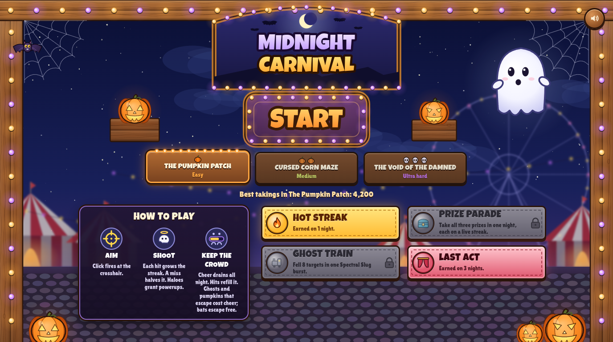
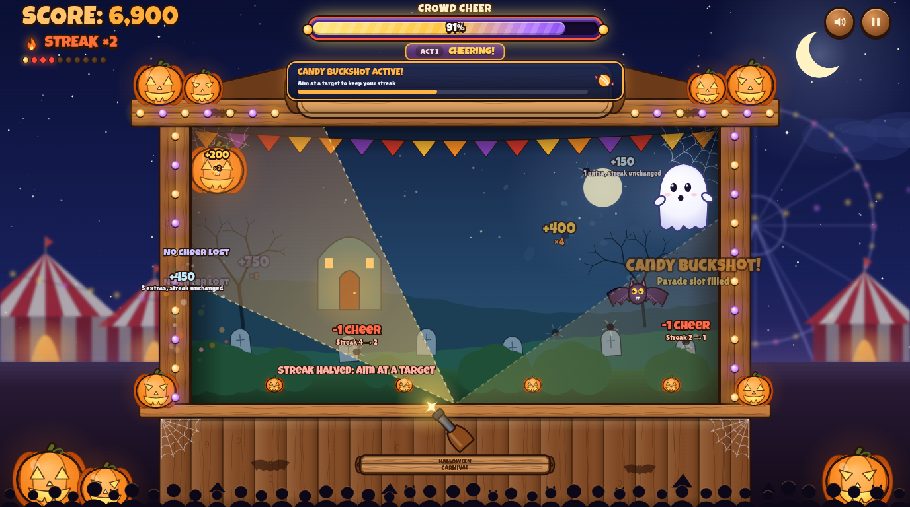
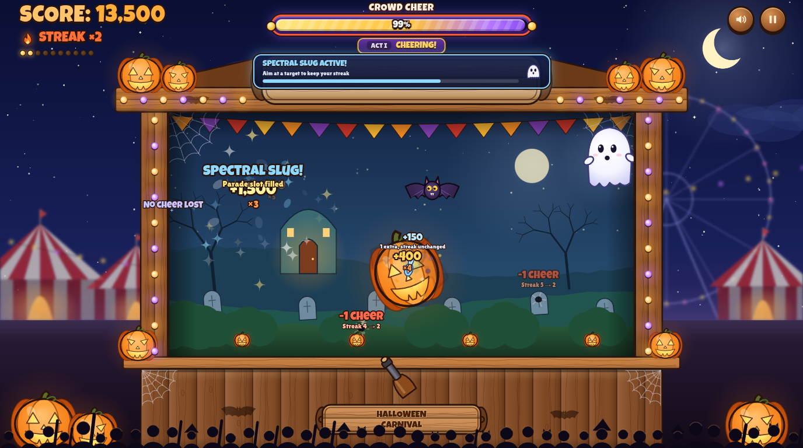

# Midnight Carnival — haunted shooting gallery prototype

Built from `docs/design/idea-board.design.md` and its three accepted mock-ups (booth, gameplay, title).

## Screenshots

## Run it

Open `index.html` in a browser. There is no build step and nothing to install; fonts are embedded in `fonts.css`, so it works from `file://`.

- Mouse: the crosshair follows the cursor and a click fires.
- Touch: tap fires where you lift. Drag past 10 px to raise the crosshair 48 px above your finger. Lift in a side strip, above the booth or below the lower aiming area to cancel.
- Esc or P pauses. M mutes. The show also pauses when the tab loses focus.

## Levels

The title has a level picker: The Pumpkin Patch (easy), Cursed Corn Maze (medium) and The Void of the Damned (ultra hard). The values at the top of `tuning.js` are The Pumpkin Patch. Each other level starts from them and changes only what its `case` sets in `setLevel()` at the bottom of that file. Best score and stamps are kept per level, and each play log records its level.

## Files

| File | What it holds |
| --- | --- |
| `tuning.js` | Every tuning value from the doc, including the Art Director's touch values. Edit here. |
| `sim.js` | The rules: cheer, streak, spawns, halo grid, powerups, stamps and the play log. No DOM. |
| `art.js` | All painted art (booth, targets, halo, crosshair, curtain), drawn with canvas paths. |
| `main.js` | Layout, input, effects, HUD, screens, saving. |
| `audio.js` | Synthesized sound effects. |
| `tools/simulate.js` | Headless fixed-accuracy bot nights: `node tools/simulate.js 0.44 1.75 200 cornMaze`. |

## Play logs

Every night is saved to `localStorage`. The results screen has a **Download play logs** link that exports all nights as JSON. Each log has every field from the doc's play-log list: shots and accuracy by input (mouse, tap, drag), cancelled taps and drags, the streak profile and its value at every break, each prize (type, act, time, outcome, multiplier), each burst (type, act, time, fells and longest chain), escapes per minute, the share of bats shot, cheer at each act start, cheer lost by drain, wild shots and escapes, crosshair clamps, and a snapshot of the tuning used.

## Bot (QA only)

`index.html?bot=0.44` lets a fixed-accuracy bot play. Add `&speed=4` to fast-forward. Bot nights are logged, but they never set a best score or earn stamps. As the protocol says, the bot is fit only for Hot Streak odds, night length, escape rate and the cheer curve.

## Where the doc was silent, and what this build does

- **Powerup shots that fell something are never misses (host's call, changes the doc).** During Spectral Slug or Candy Buckshot, if the crosshair is on empty booth but the chain or fan still fells at least one target, the shot costs no cheer and the streak holds. It doesn't grow; only aimed hits do, so Hot Streak stays aimed-only. A burst shot that fells nothing is still a normal miss. The doc's "Rules: prizes and the night" and "Tuning" sections still describe the old rule (a wild shot even when extras fall).
- **Slug during a wild shot.** The doc says a wild shot costs and halves the streak "even when a fan or a chain fells targets anyway". So during Spectral Slug, a wild shot still leaps from the shot point to the nearest target in reach.
- **Chains and fans skip prize targets.** A burst can't fell a halo as an extra. With a 25 s grid and 6 s bursts, a prize is almost never on screen during a burst anyway.
- **An escaped prize when the bag is empty.** Its type goes behind the other two types, so the next halo is always a different type.
- **Touches that start outside the booth and lower area** (strips, HUD) are ignored rather than becoming drags.
